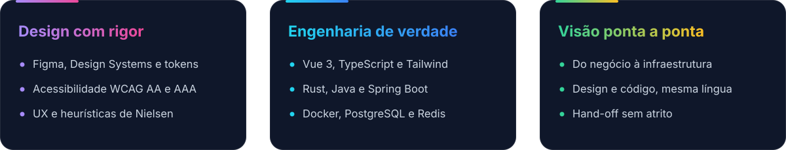
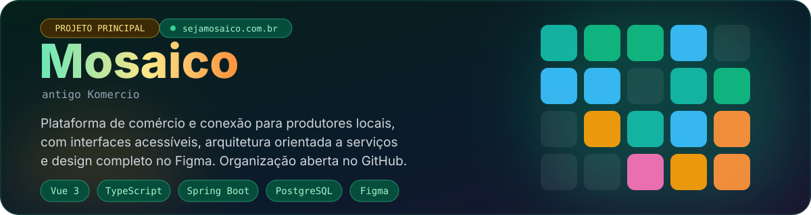
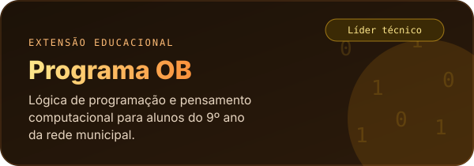
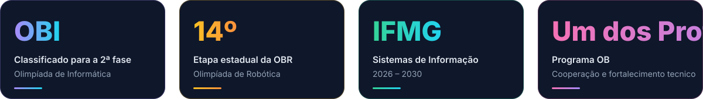

 

 

 

> Eu enxergo o produto **de ponta a ponta**: da necessidade de negócio e da psicologia do usuário até a infraestrutura e a persistência de dados. Falo a língua do **designer** e a do **engenheiro**, e é aí que o atrito do *hand-off* some.

 

 

**Design & UX**

 

**Frontend**

**Backend & Sistemas**

**Dados, Infra & Hardware**

**IA no fluxo de desenvolvimento**

 

 

 

 

 

 

 

 

  

<picture>
  <source media="(prefers-color-scheme: dark)" srcset="https://raw.githubusercontent.com/AntonnyCaldeiraSilva/AntonnyCaldeiraSilva/output/github-contribution-grid-snake-dark.svg" />
  <source media="(prefers-color-scheme: light)" srcset="https://raw.githubusercontent.com/AntonnyCaldeiraSilva/AntonnyCaldeiraSilva/output/github-contribution-grid-snake.svg" />
  
</picture>

 

 

Se você busca alguém que **desenhe, programe e converse com os dois lados do time**, vai ser um prazer trocar ideia.

 

