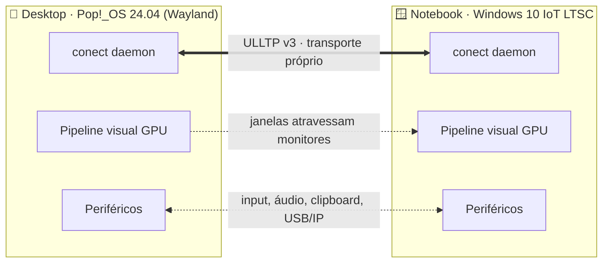

 

**Sistemas de Informação @ IFMG** · Ouro Branco, MG 🇧🇷

 

 

## ✨ Em uma frase

> Eu enxergo o produto **de ponta a ponta**: da necessidade de negócio e da psicologia do usuário até a infraestrutura e a persistência de dados. Falo a língua do **designer** e a do **engenheiro**, e é aí que o atrito do *hand-off* some.

 

## 🎯 O que eu faço de melhor

<table>
<tr>
<td width="50%" valign="top">

### 🎨 Design com rigor
- **Figma avançado:** Auto-layout, variantes, variáveis nativas e protótipos de alta fidelidade
- **Design Systems & Tokens:** arquitetura atômica, espaçamento, cor, tipografia e elevação
- **Acessibilidade (WCAG AA/AAA):** foco por teclado, contraste, ARIA e leitores de tela
- **UX aplicado:** Lei de Hick, Lei de Fitts, Efeito Estética-Usabilidade e heurísticas de Nielsen

</td>
<td width="50%" valign="top">

### ⚡ Engenharia de verdade
- **Frontend moderno:** Vue 3 (Composition API, `<script setup>`), TypeScript, Tailwind
- **Backend & sistemas:** Rust, Java/Spring Boot, Node.js, C/C++
- **Distribuídos:** concorrência segura, resiliência de rede e otimização de latência
- **Infra:** Docker, GitHub Actions, Linux, PostgreSQL, Redis

</td>
</tr>
</table>

 

## 🛠️ Stack

**Design & UX**

**Frontend**

**Backend & Sistemas**

**Dados, Infra & Hardware**

**IA no fluxo de desenvolvimento**

 

## 📌 Projetos em destaque

**Fusão simbiótica invisível entre Windows 10 e Linux (Wayland).** Um daemon em segundo plano que faz o segundo computador se comportar como **uma tela a mais** do primeiro: você arrasta uma janela para o outro monitor e a tarefa passa para a outra máquina, sem janela de acesso remoto e sem compressão destrutiva 4:2:0.

#### 🎯 Metas de projeto

| ⚡ Janelas entre monitores | 🖱️ Periféricos | 🔀 Migração de tarefas | 🎧 Áudio |
| :---: | :---: | :---: | :---: |
| **1,65 a 3,80 ms**  Zero-Copy UMA + VRR | **0 ms**  de reconciliação | **≤ 0,48 ms**  corte especulativo S2P | **≤ 5 ms**  PipeWire ↔ WASAPI |

Valores definidos na especificação do projeto como metas de latência, validados pela bancada Clique→Pixel.

<b>🏛️ Os 8 pilares da arquitetura (clique para expandir)</b>

 

| Pilar | Domínio | Destaques |
| :--- | :--- | :--- |
| **1 · Posse e Consistência** | Épocas e consenso entre as máquinas | Leases monotônicos, compensação de *clock drift*, *fencing tokens* e prova formal em **TLA+** |
| **2 · Transporte e Rede** | Protocolo **ULLTP v3** | Cabeçalho fixo de 32 B (`#[repr(C)]`), `io_uring` / Winsock RIO, codificação de rede AC-CRLNC, criptografia AEGIS-128L |
| **3 · Pipeline Visual** | Zero-Copy UMA | Codec GPU G-SLIC (YCoCg-R, wavelet CDF 5/3), protocolo foveado FSVP e VRR |
| **4 · Live Migration** | Handoff de tarefas | Wasmtime com ABI própria, corte especulativo S2P, Conect-VFS v2 (`FUSE_PASSTHROUGH` / ProjFS + FastCDC) |
| **5 · Observabilidade** | Telemetria lock-free | *Ring buffers* SPSC alinhados em cache, vetor de pressão do nó a cada 10 ms |
| **6 · Escalonador Silencioso** | Proteção contra sobrecarga | 4 zonas com histerese (Schmitt), escudo Anti-Swap/OOM e modo *Thin-Viewport* com 0 CPU |
| **7 · Periféricos** | Barramento virtual | Input P0 de 24 B com bitmask anti-tecla-presa, clipboard *delayed-rendering*, câmera e USB/IP |
| **8 · Workspace Cargo** | Organização do código | DAG de 5 camadas, padrão **Sans-IO**, `unsafe` isolado em `conect-sys` e *gatekeeper* arquitetural |
| **UI 1–4 · Painel nativo** | Sob demanda | `conect-ui` (Iced + wgpu, 0 MB quando fechado), `conect-tray`, `conect doctor` e IPC com `rkyv` |

<b>📦 Governança e engenharia de processo</b>

 

- **Versionamento semântico tridimensional:** versão do software, do protocolo ULLTP e do IPC evoluem de forma independente
- **Trunk-Based Development** com *Conventional Commits* e checklist de gatekeeper arquitetural
- **Documentação formal** mantida em um vault do Obsidian, com um documento por pilar
- Arquivos de governança: `VERSIONING.md`, `CONTRIBUTING.md` e `CHANGELOG.md`

 

<table>
<tr>
<td width="50%" valign="top">

### 🧩 Mosaico
antigo *Komercio*

Plataforma de comércio e conexão para **produtores locais**, mantida como organização aberta no GitHub. Interfaces acessíveis, arquitetura orientada a serviços e design feito no Figma.

`Vue 3` `TypeScript` `Spring Boot` `PostgreSQL` `Figma`

</td>
<td width="50%" valign="top">

### 🎓 Programa OB
extensão educacional

Idealizei e lidero tecnicamente o projeto que ensina **lógica de programação e pensamento computacional** a alunos do 9º ano da rede municipal, com foco em inclusão digital.

`Algoritmos` `Didática` `Mentoria`

</td>
</tr>
</table>

 

## 🏆 Conquistas

| 🥇 **OBI** | 🏅 **OBR** | 🎓 **IFMG** | 🤝 **Programa OB** |
| :---: | :---: | :---: | :---: |
| Classificado para a **2ª fase** da Olimpíada Brasileira de Informática | **14º lugar** na etapa estadual da Olimpíada Brasileira de Robótica | **Sistemas de Informação** (2026–2030) | **Líder técnico** e idealizador |

 

## 💡 Como eu trabalho

- 🧠 **Menos carga cognitiva, mais clareza:** decisões de interface baseadas em Hick, Fitts e heurísticas, não em achismo
- ♿ **Acessibilidade desde o dia 1:** a11y como requisito de arquitetura, não como remendo no fim
- 🔗 **Design e código falando a mesma língua:** tokens do Figma que viram variáveis reais no código
- 🧪 **Rigor técnico:** segurança de tipos, consistência de código e soluções ancoradas em padrões de mercado
- 🚀 **Aprendizado acelerado:** pego paradigmas de fronteira (Rust, MCP, design tokens) e transformo em projetos funcionando
- 🌱 **Empatia pelo usuário final:** projetos pensados para escolas públicas e produtores locais

 

## 📊 GitHub em números

 

 

## 🐍 Contribuições

<picture>
  <source media="(prefers-color-scheme: dark)" srcset="https://raw.githubusercontent.com/AntonnyCaldeiraSilva/AntonnyCaldeiraSilva/output/github-contribution-grid-snake-dark.svg" />
  <source media="(prefers-color-scheme: light)" srcset="https://raw.githubusercontent.com/AntonnyCaldeiraSilva/AntonnyCaldeiraSilva/output/github-contribution-grid-snake.svg" />
  
</picture>

 

## 📫 Vamos conversar?

Se você busca alguém que **desenhe, programe e converse com os dois lados do time**, vai ser um prazer trocar ideia.

 

